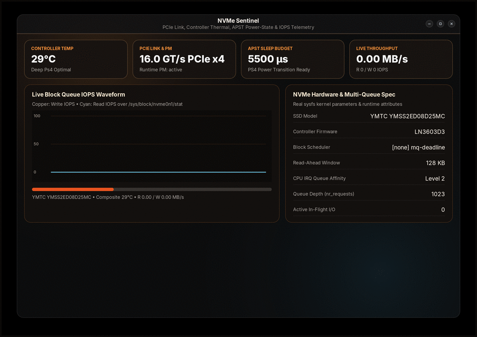
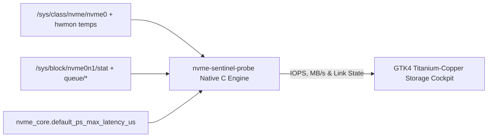
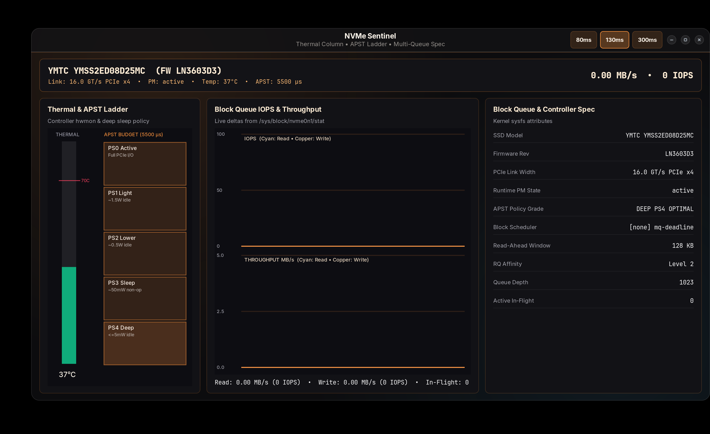

# NVMe Sentinel

[](LICENSE)
[](#architecture)
[](#gallery)
[](https://github.com/lwrlock/ff-power-manager)

**Real-time Linux NVMe controller thermal monitor, APST PS4 sleep-latency auditor, PCIe link speed probe, and multi-queue IOPS telemetry cockpit in C and Python/GTK4.**

<p align="center">
  
</p>

## Architecture



## Highlights

- **PCIe & Controller Telemetry:** Inspects live Gen4/Gen5 link speed/width (`16.0 GT/s PCIe x4`), Runtime PM status, and `hwmon` Composite temperatures (`°C`).
- **APST Deep Sleep Budget:** Tracks `nvme_core.default_ps_max_latency_us` (`5500 µs` PS4 readiness) and block queue knobs (`scheduler`, `read_ahead_kb`, `rq_affinity`, `nr_requests`).
- **Live Block IOPS & Throughput:** Measures `/sys/block/nvme*/stat` deltas for Read/Write IOPS and MB/s waveforms cleanly.

<details>
<summary><b>Full-Resolution UI Screenshot</b></summary>

<p align="center">
  
</p>

</details>

## Build & Run

```bash
make test
./nvme-sentinel-probe --json
PYTHONPATH=src /usr/bin/python3 -m nvme_sentinel.gui
```

---

### FF Linux Kernel & Systems Suite
[FF Power Manager](https://github.com/lwrlock/ff-power-manager) · [eBPF Latency Guard](https://github.com/lwrlock/ebpf-latency-guard) · [VRAM Atlas](https://github.com/lwrlock/vram-atlas) · [Waylens Privacy](https://github.com/lwrlock/waylens-privacy) · [MemPulse](https://github.com/lwrlock/mempulse) · [NetPulse BPF](https://github.com/lwrlock/netpulse-bpf) · **NVMe Sentinel**

MIT License — Copyright (c) 2026 Furkan (**lwrlock**). Built with assistance from Google DeepMind Antigravity.
